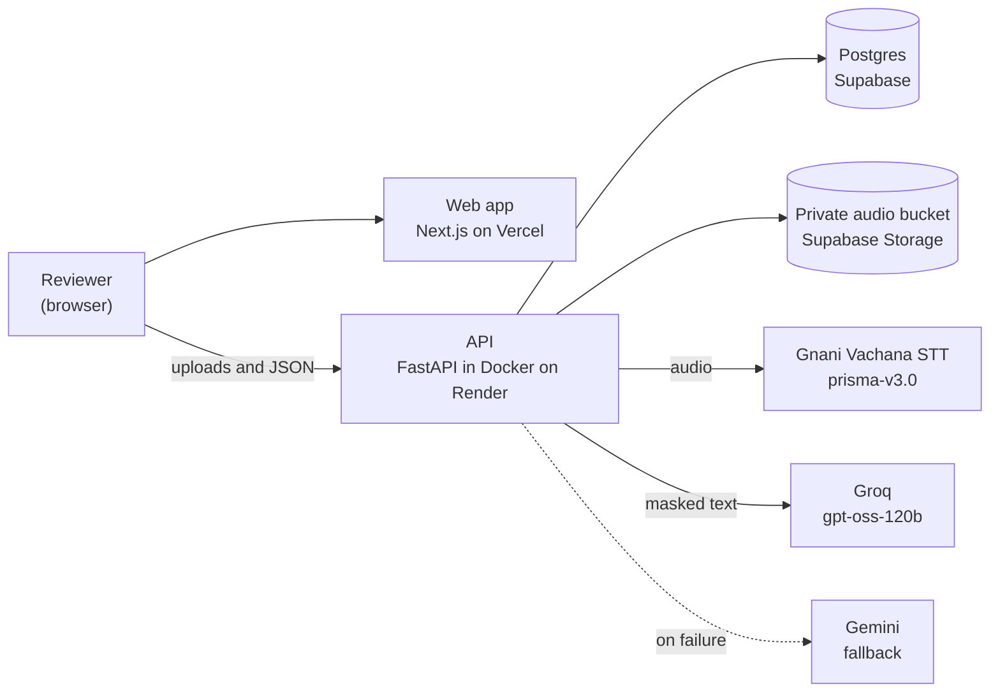

# Samaritan

**An AI auditor for loan-recovery calls.** A lender uploads call recordings. Samaritan transcribes them with Gnani's speech-to-text, works out who is the agent and who is the borrower, checks nine RBI-style recovery-conduct rules, and pins every violation on the audio waveform so a reviewer can hear the exact moment, then confirm or dismiss it. Each call and each agent gets a compliance score, and the app publishes its own measured accuracy.

- **Live demo:** https://samaritan-six.vercel.app (the first load can take up to a minute while the free API server wakes up)
- **Who it is for:** compliance teams, QA leads and anyone who has to audit collection calls at a lender or a collections agency.
- **Browsing is open.** Uploading your own call needs a demo passcode, because every upload spends speech-to-text and LLM credits. The passcode is shared in the launch post and on request.

> All data in this project is synthetic. The lender, the borrowers and the agents are fictional, and no real names, phone numbers or recordings are used.

## The problem

RBI's guidance on recovery agents is clear: no calls before 8 am or after 7 pm, no abuse, no threats, no telling the borrower's employer or neighbours about the debt, no posing as the police or a court. A lender makes thousands of calls a day and nobody can listen to all of them, so these rules mostly get checked after something has already gone wrong. Samaritan listens to every call.

## The nine rules

| | Rule | Severity |
|---|---|---|
| V1 | Call outside permitted hours (before 08:00 or after 19:00 IST, unless the borrower asked for that time) | high |
| V2 | Abusive or insulting language | critical |
| V3 | Threat of physical harm or force | critical |
| V4 | False legal threat (arrest, police, court that is not real) | critical |
| V5 | Public shaming or threat to inform others | high |
| V6 | Debt disclosed to a third party | high |
| V7 | Impersonation or false authority | critical |
| V8 | No self or lender identification | medium |
| V9 | Undue pressure or intimidation | medium |

The rule texts live in [`api/app/config/rules.yaml`](api/app/config/rules.yaml). The RBI clause numbers in the app are marked "[to verify]" in [docs/rbi-references.md](docs/rbi-references.md); they are drafts, not confirmed citations.

## How it works



Each call moves through a single in-process worker:

1. **Transcribe.** The audio is converted to 16 kHz mono and sent to Gnani's batch speech-to-text with diarization (two speakers). The transcript is cached, so re-analysing never costs credits twice.
2. **Map roles.** Each speaker is scored on how much they sound like a collections agent (naming the lender, talking about EMIs and dues) versus a borrower; the higher score is the Agent, and ties go to whoever speaks first. A reviewer can swap the roles if it is wrong.
3. **Layer 1, rules.** Deterministic checks: the call-time rule (V1), whether the lender was named early enough (V8), and Hinglish and Marathi lexicons that find candidate lines for the other rules.
4. **Layer 2, LLM judge.** Candidate lines and their context go to an LLM (Groq `gpt-oss-120b`, Gemini as fallback) with names and numbers masked. It decides whether each line really breaks the rule.
5. **Evidence check.** Every flag must quote the transcript. If the quoted text is not in the call, the flag is discarded. The LLM cannot invent a violation.
6. **Score and review.** Flags are merged, deduplicated and scored by severity. A reviewer confirms or dismisses each one, and the score updates.

More detail, including the data model and the API, is in [architecture.md](architecture.md). Every non-obvious choice is recorded in [docs/decisions.md](docs/decisions.md), and what the speech-to-text model actually does on this audio is in [docs/gnani-findings.md](docs/gnani-findings.md).

## Results, stated honestly

Measured on the labelled calls with Gnani config A (prisma-v3.0, Hindi and English, diarization). A flag counts as correct when it names the right rule and starts within 5 seconds of the labelled moment (V1 and V8 match on the rule alone).

| Slice | Calls | Precision | Recall |
|---|---|---|---|
| Rules + LLM, all labelled calls | 22 | 84% | 91% |
| Rules + LLM, development calls | 8 | 78% | 88% |
| **Rules + LLM, held-out test calls** | **14** | **88%** | **93%** |
| Rules only (no LLM), all calls | 22 | 66% | 83% |

- Clean calls wrongly flagged: **0 of 8** with the LLM, 5 of 8 with rules only.
- Timestamp accuracy among correct detections: 95%. Speaker-role mapping: 100%.
- The detection rules were tuned on the development calls only; the held-out calls were never used for tuning. When errors showed up on held-out calls, I did not change the rules or the answer keys to fit them (see D-032 in the decisions log).

**Read these numbers with care:**

- **Small sample.** 22 calls is far too few to claim a general accuracy. Treat this as a promising prototype, not a proven auditor.
- **Acted calls, one real voice.** The calls were recorded from scripts. I played the agent on a microphone, and a computer voice (macOS "Rishi") played the borrower, because I had nobody to record with. Two very different voices are easier to tell apart than two real callers, so the speaker-role number flatters the system.
- **Same author.** The scripts, the rules and the answer keys were all written by the same person.
- **No Marathi results.** The code has Marathi patterns and the 8 Marathi scripts exist in `data/scripts/`, but none was recorded, so Marathi is untested. The app does not claim to handle it.
- **Real audio only on the recorded calls.** The planned test set has 30 scripts; 22 were recorded and measured.

The full per-rule table and every known failure are in the latest report under [`eval/reports/`](eval/reports/), and on the live site's Accuracy page.

## Tech stack

| Part | Choice |
|---|---|
| Speech-to-text | Gnani Vachana batch API, model `prisma-v3.0` |
| LLM judge | Groq `openai/gpt-oss-120b`, Gemini as fallback, with a token-aware rate limiter and a response cache |
| API | Python 3.11, FastAPI, SQLAlchemy 2, Alembic, ffmpeg |
| Database and storage | Supabase Postgres (row-level security on, no public access) and a private audio bucket with short-lived signed links |
| Web | Next.js 16, React 19, TypeScript (strict), Tailwind, TanStack Table, wavesurfer.js |
| Hosting | Render (API, Docker, free plan), Vercel (web) |
| Tests | about 400 backend tests (pytest, run on SQLite and on a real local Postgres), ESLint and ruff clean |

## Run it yourself

You need Node 20 or newer, Python 3.11 or newer, and ffmpeg (`brew install ffmpeg` on macOS).

### 1. Try the whole app with no keys

This runs the real API code against fake Gnani and LLM servers, so it costs nothing and needs no accounts.

```bash
cd api
python3.11 -m venv .venv
.venv/bin/pip install -e ".[dev]"
.venv/bin/python -m app.devserver        # API on http://localhost:8000
```

In a second terminal:

```bash
cd web
npm install
cp .env.example .env.local
# in .env.local set: NEXT_PUBLIC_DATA_SOURCE=api
npm run dev                              # web on http://localhost:3000
```

Leave `NEXT_PUBLIC_DATA_SOURCE=mock` instead to run the web app alone on built-in sample data.

### 2. Run against real Gnani and LLM keys

```bash
cd api
cp .env.example .env                     # then fill in GNANI_API_KEY, GROQ_API_KEY, GEMINI_API_KEY
.venv/bin/python -m app.migrate          # creates the tables (SQLite by default)
.venv/bin/uvicorn app.main:app --reload
```

Uploading a call, or re-running one with re-transcription, spends Gnani and LLM credits; browsing and re-analysing from the cached transcript do not. Setting `DEMO_MODE=true` and an `UPLOAD_PASSCODE` locks uploads behind a passcode.

### 3. Deploy

`render.yaml` describes the API service for Render (Docker, free plan). [`supabase/README.md`](supabase/README.md) walks through the database, the lock-down SQL and the seed scripts. The web app deploys to Vercel with the root directory set to `web` and these variables: `NEXT_PUBLIC_API_BASE_URL`, `NEXT_PUBLIC_DATA_SOURCE=api`, `NEXT_PUBLIC_DEMO_MODE=true`. After the Vercel address exists, add it to the API's `CORS_ORIGINS`.

### 4. Tests, evaluation, smoke test

```bash
cd api && .venv/bin/pytest && .venv/bin/ruff check .       # no network, no credits
cd api && TEST_PG=1 .venv/bin/pytest                      # the same suite on a throwaway local Postgres
cd web && npm run lint && npm run build
python3 scripts/smoke.py --base-url http://localhost:8000  # read-only checks of a running API

api/.venv/bin/python eval/run_eval.py run                  # evaluate the cached transcripts (free)
api/.venv/bin/python eval/run_eval.py ingest               # transcribe new recordings (asks before spending credits)
```

## The test set

`data/scripts/` holds 30 scripted calls (22 Hinglish, 8 Marathi) and `data/answer_keys/` holds what each should and should not flag, including which calls are clean on purpose and which are hard (a firm but polite agent that must not be flagged). [`data/COVERAGE.md`](data/COVERAGE.md) shows how the rules, languages and noise conditions are covered. The recordings are not in the repository.

To record calls yourself, [`data/RECORDING_GUIDE.md`](data/RECORDING_GUIDE.md) explains the two-person method, and `scripts/record_call.py` lets one person record alone with a computer-voice borrower.

## Limitations and what comes next

- Accuracy is measured on a small, acted, mostly single-voice set (above). Real calls will be messier.
- Marathi is untested on real audio.
- The RBI clause numbers still need checking against the primary documents.
- The free Render plan sleeps after about 15 minutes idle, and the worker runs inside the API process, so a very large batch would need a real job queue.
- Flags are decision support for a human reviewer, not legal findings.

Next steps would be recording real two-person calls, a Marathi run, confirming the RBI citations, and a proper job queue.

## Repository map

- `api/` FastAPI service: detection engine, Gnani client, LLM layer, worker, evaluation code, migrations
- `web/` Next.js app
- `data/` scripts, answer keys, coverage matrix, recording guide
- `eval/` evaluation entry points and generated reports
- `scripts/` seed, migrate, reset, smoke test and the solo recorder
- `supabase/` lock-down SQL and setup notes
- `docs/` decisions log, speech-to-text and LLM findings, RBI references
- `plan.md`, `architecture.md`, `progress.md` the build spec, the design, and the running status
