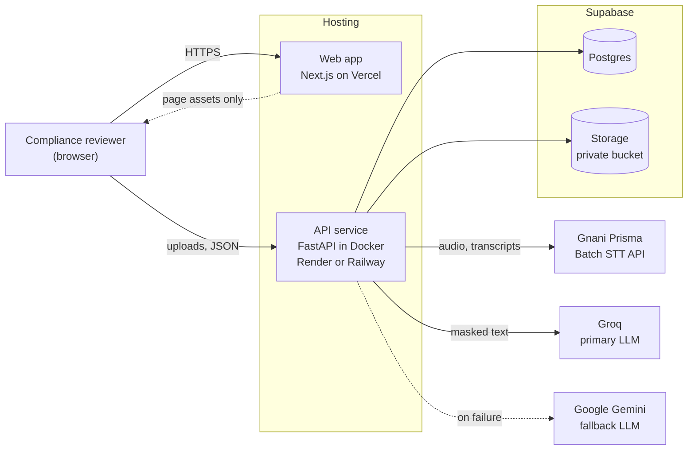
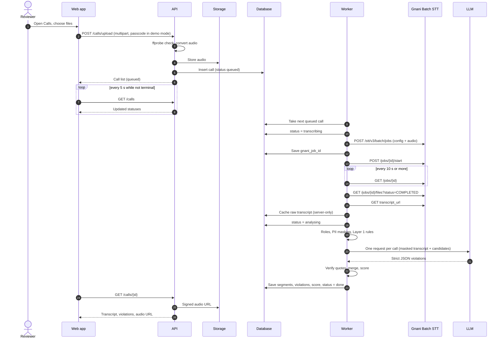
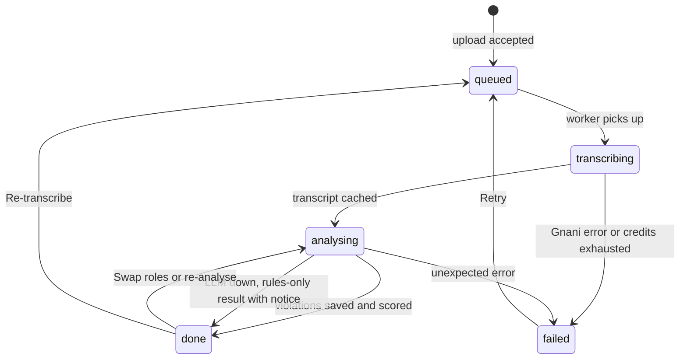
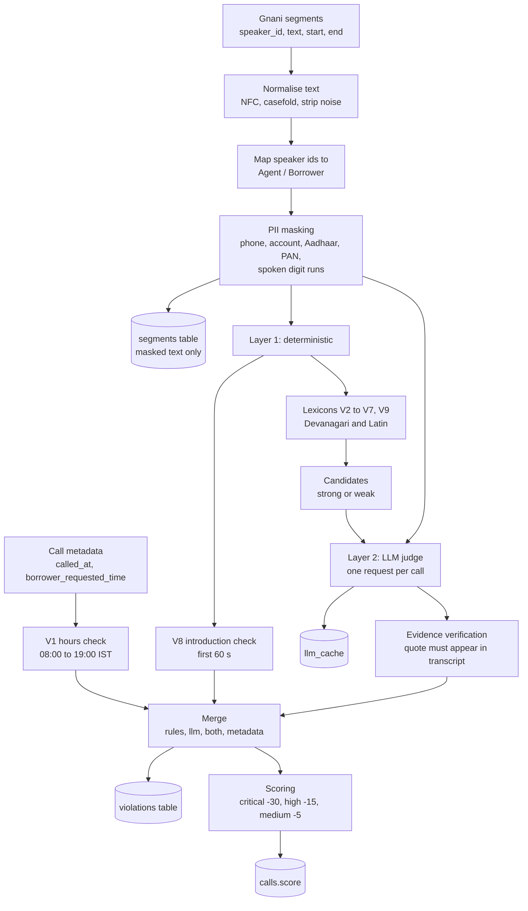
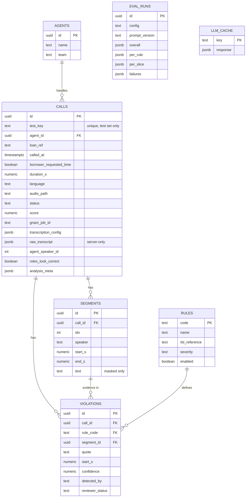
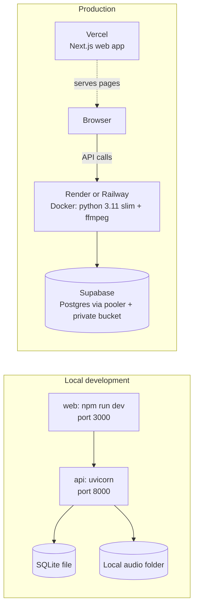
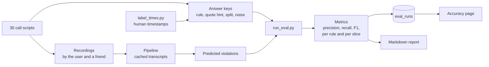

# Samaritan — Architecture

Samaritan audits loan-recovery phone calls for Indian lenders. A compliance team uploads recordings; the system transcribes them with Gnani Prisma, detects violations of RBI recovery-conduct rules with a two-layer engine, scores calls and agents, and publishes its own measured accuracy.

> **Relationship to plan.md:** `plan.md` is the build specification (what to build, in which phase, acceptance criteria). This file explains **how the system is structured and why**. If the two disagree on a requirement, `plan.md` wins; update this file to match. Diagrams use Mermaid and render on GitHub and most Markdown viewers.

**Contents:** 1 System context · 2 Components · 3 Processing pipeline · 4 Call lifecycle · 5 Detection engine · 6 Data model · 7 Frontend · 8 API · 9 Data boundaries and security · 10 Deployment · 11 Reliability · 12 Evaluation · 13 Design decisions · 14 Extension points

---

## 1. System context



Key properties:
- The **browser talks directly to the API** for data and uploads. The Next.js app serves pages and assets; it holds no secrets and never calls Gnani, an LLM, or Supabase.
- **All secrets live in the API service only** (Gnani key, LLM keys, Supabase service key).
- Only **masked** transcript text is ever sent to an LLM.

---

## 2. Components

| Component | Runs in | Responsibility |
|---|---|---|
| **Web app** | Vercel (Next.js App Router, TypeScript) | Six pages, theme, tables and charts, audio player with transcript sync, upload drawer, printable evidence page |
| **API layer** | FastAPI | REST endpoints, validation, error envelope, demo-mode guards, CORS |
| **Worker** | In the API process | Single-queue background processor that moves each call through the pipeline; resumes unfinished calls on startup |
| **Audio service** | API (ffmpeg) | Probe and validate uploads, convert to 16 kHz mono WAV (FLAC fallback), enforce size and length limits |
| **Gnani client** | API (httpx) | Batch job lifecycle (create, start, poll, list files, download), retries, error normalisation, transcript caching |
| **Detection engine** | API | Normalisation, speaker-role mapping, PII masking, Layer 1 rules, Layer 2 LLM judge, evidence verification, merge |
| **LLM layer** | API | Provider abstraction (Groq, Gemini), token-aware rate limiter, response cache, fallback |
| **Scoring** | API | Per-call and per-agent scores from non-dismissed violations of enabled rules |
| **Persistence** | SQLAlchemy + Alembic | One codebase for SQLite (local) and Postgres (Supabase) |
| **Storage** | Local folder or Supabase Storage | Audio files behind a small interface; signed URLs for playback |
| **Evaluation harness** | CLI scripts | Runs the pipeline on the labelled test set, computes metrics, writes `eval_runs` and a Markdown report |

---

## 3. Processing pipeline



Notes:
- **One Gnani job per call**, processed **one at a time** (Gnani may enforce a single active request).
- `gnani_job_id` is saved the moment the job exists, so a restart **resumes polling** instead of creating a duplicate job (and spending credits twice).
- If a call already has a cached transcript, Gnani is skipped entirely.

---

## 4. Call lifecycle



- On server startup, calls left in `queued`, `transcribing` or `analysing` are re-enqueued.
- A failing call never stops the queue. A credits error stops the queue and is reported to the user.

---

## 5. Detection engine



**Two configurations** are always measurable:
- `rules_only` — every Layer 1 hit (strong and weak), no LLM. This is the baseline.
- `rules_plus_llm` — the LLM has the final say on Layer 1 candidates, may add flags that no keyword catches, and every flag must pass quote verification.

**Why the LLM sees one request per call:** the free Groq tier is limited to roughly 8,000 tokens per minute, and Devanagari text is token-heavy. One request per call, a response cache, and a token-aware limiter keep runs inside the limits. If Groq fails repeatedly, the same call falls back to Gemini.

**Trust boundaries inside the engine:**
- V1 is purely deterministic; the LLM never decides it.
- An LLM flag without a verifiable quote is discarded, so the model cannot invent evidence.
- If the LLM is unavailable after fallback, Layer 1 results are kept and the call shows an "Analysed without LLM" notice.

---

## 6. Data model



`EVAL_RUNS` and `LLM_CACHE` are standalone tables. The full reference SQL is in `plan.md` Section 11. Schema changes are made through SQLAlchemy models and Alembic migrations, which work on both SQLite and Postgres.

---

## 7. Frontend architecture

- **Routes:** `/` Overview · `/calls` · `/calls/[id]` · `/calls/[id]/evidence` · `/agents` · `/agents/[id]` · `/rules` · `/accuracy`.
- **Data access through one interface.** Every page and component imports only from `lib/api`, which exposes a typed client interface. Two implementations exist: `mockClient` (Phase 1, realistic fake data) and `httpClient` (real API). `NEXT_PUBLIC_DATA_SOURCE` picks one, so connecting the real backend is a swap, not a rewrite.
- **Shared types** in `lib/types.ts` mirror the API's Pydantic schemas (snake_case, same field names).
- **Polling, not websockets:** while any call is non-terminal, the Calls list refetches every 5 seconds.
- **Client-only pieces:** the audio player (wavesurfer.js) and charts (Recharts) are client components.
- **Theming:** CSS variables and shadcn theme tokens drive light and dark; one accent colour; severity colours are reserved for severity and status.
- **Demo mode UX:** the upload drawer asks for a passcode (kept in `sessionStorage`); a "waking up" state appears when `/health` is slow on a sleeping free host.
- **Uploads go straight from the browser to the API**, not through Next.js route handlers, to avoid serverless request-size limits.

---

## 8. API surface

REST over JSON, `snake_case`, times in ISO-8601 with `+05:30`, errors as `{"error": {"code", "message"}}`, lists as `{items, page, page_size, total}`.

| Area | Endpoints |
|---|---|
| Health and stats | `GET /health`, `GET /stats/overview` |
| Calls | `GET /calls`, `POST /calls/upload`, `GET /calls/{id}`, `GET /calls/{id}/audio`, `POST /calls/{id}/retry`, `POST /calls/{id}/swap-roles` |
| Review | `PATCH /violations/{id}` |
| Agents | `GET /agents`, `POST /agents`, `GET /agents/{id}` |
| Rules | `GET /rules`, `PATCH /rules/{code}` |
| Evaluation | `GET /eval/latest`, `POST /eval/run` (admin token) |

Exact request and response shapes are in `plan.md` Section 10. Routers contain no business logic; they call services (pipeline, scoring, detection, storage).

---

## 9. Data boundaries and security

| Concern | Design |
|---|---|
| **Secrets** | Only in `api/.env` locally and in the hosting dashboards in production. The web app has only a public API URL and a mode switch. `.env*` is git-ignored |
| **PII** | Masked immediately after transcription. Only masked text is stored in `segments` and sent to LLMs. The raw Gnani JSON is cached in `calls.raw_transcript`, which no API response ever includes |
| **Synthetic data** | All calls are acted out from scripts. No real names, numbers, Aadhaar, PAN or real recordings |
| **Database access** | RLS enabled on every table with no public policies. Only the API connects (service role / direct connection). The browser never talks to Supabase |
| **Audio** | Private bucket; the API issues short-lived signed URLs |
| **Public demo abuse** | With `DEMO_MODE=true`, upload, retry, swap-roles and eval-run require a passcode and are rate-limited per IP; file type and size are checked with `ffprobe`. Seeded calls work without a passcode. `scripts/reset_demo.py` restores the seeded state |
| **Not legal findings** | The UI and evidence page state that flags are decision support requiring human review |

---

## 10. Deployment topology



- The API image is built from `api/Dockerfile` (Python 3.11-slim plus ffmpeg).
- On IPv4-only hosts, connect to Supabase through the **pooler connection string**, not the direct one.
- Switching from local to production changes only environment variables: `DATABASE_URL`, `STORAGE_BACKEND`, Supabase keys, `DEMO_MODE`, `UPLOAD_PASSCODE`, `CORS_ORIGINS`, and the web app's `NEXT_PUBLIC_*` values.
- Free hosting tiers sleep and restart, which is why the worker resumes unfinished calls on startup.

---

## 11. Reliability and failure handling

| Failure | Behaviour |
|---|---|
| Gnani 429, 500, 503, 504, network error | Retry with backoff (0.5 s, 1 s, 2 s; 3 attempts) |
| Gnani other 4xx | No retry; call marked `failed` with the message |
| Gnani 402, or 403 mentioning credits or organisation | Stop the whole queue, mark the call `failed`, tell the user |
| Gnani job ends `FAILED`, `START_FAILED`, `CANCELLED` | Call marked `failed` with the job's reason; Retry button in the UI |
| Server restart mid-call | On startup, re-enqueue; resume polling the saved `gnani_job_id` |
| Groq 429 or invalid JSON | Backoff and one retry; after repeated failure switch that call to Gemini |
| Both LLMs unavailable | Keep Layer 1 results, flag the call with a visible notice |
| LLM invents a quote | Discarded by evidence verification |
| Speaker roles swapped by diarization | LLM reports `roles_look_correct: false`; UI banner and "Swap roles" re-run detection only |
| Oversized or non-audio upload | Rejected at upload with a clear message |
| Free host cold start | UI shows a waking-up state until `/health` responds |

Logging is structured and never contains keys or transcript text from real data.

---

## 12. Evaluation architecture



- Predictions are compared with answer keys per call and per rule. A strict match requires the same rule and a timestamp within ±5 seconds of the human-labelled moment (V1 and V8 match on rule only).
- Both configurations are evaluated on the same cached transcripts, so differences come from detection, not from transcription variance.
- **Tuning uses the 10 `dev` calls only.** The 20 `test` calls stay held out, and the Accuracy page shows both.
- Slices: all, dev, test, Hinglish, Marathi, noisy audio (with and without Gnani denoise).

---

## 13. Key design decisions

| Decision | Why | Trade-off |
|---|---|---|
| Gnani **Batch** API, not the synchronous endpoint | Calls last 1–3 minutes; the synchronous API handles only short clips and gives no speaker separation | Polling latency (10 s minimum interval) |
| **One Gnani job per call**, serial | Simple status mapping, resumable, respects possible single-request limits | Slower than batching many files per job |
| **Rules plus LLM**, LLM has the final say | Keywords alone are noisy; LLM alone is unverifiable | Needs evidence verification and caching |
| **Evidence verification** of every LLM quote | Prevents fabricated evidence in a compliance product | Some correct flags are dropped if the quote is paraphrased |
| **One LLM request per call** + cache | Fits free-tier token limits; reruns are free | Large transcripts need chunking |
| **Mask before store and before LLM** | Privacy story holds end to end | Masking quality directly affects detection of numbers |
| **Single SQLAlchemy codebase** for SQLite and Postgres | Phase 3 is a configuration change, not a rewrite | Must stay within portable column types |
| **Mock client behind one interface** | Frontend can be built and reviewed before the backend exists | Mock shapes must match the API contract exactly |
| **No login, passcode-guarded cost actions** | Judges can open the link and explore instantly | Public write endpoints need rate limits and a reset script |
| **Polling instead of websockets** | Fewer moving parts on free hosting | Up to 5 s delay on status updates |
| **Held-out test split** | Honest accuracy claims | Only 20 calls, so per-rule numbers are noisy |

---

## 14. Extension points (future work, not in the MVP)

- **Live monitoring:** Gnani's streaming WebSocket could feed the same detection engine in near-real time.
- **Dialer integrations:** a connector that pulls recordings and metadata from a lender's calling system instead of manual upload.
- **Login and multi-tenancy:** add auth, a `workspace_id` on every table, and per-workspace rules and lexicons.
- **More languages:** Gnani supports ten Indian languages; each needs lexicons and test calls.
- **Recording-notice and grievance-officer disclosure checks:** reported in the 2026 RBI directions; verify the wording before adding as V10 and V11.
- **Regulator view:** a read-only evidence workflow for an ombudsman or supervisor reviewing complaints.
- **Hosted queue:** move the in-process worker to a managed queue if volume outgrows a single instance.

---

## Appendix — Repository layout

```
samaritan/
├── plan.md                 build specification
├── architecture.md         this file
├── README.md
├── docs/                   decisions.md, gnani-findings.md
├── web/                    Next.js app (routes, components, lib/api, lib/mock, lib/types.ts)
├── api/                    FastAPI app (routers, services, detection, storage, worker, alembic, tests, Dockerfile)
├── supabase/               rls_and_storage.sql
├── eval/                   run_eval.py, metrics.py, label_times.py, reports/
├── scripts/                seed.py, reset_demo.py, migrate_local_to_supabase.py, smoke.py
├── submission/             demo_script.md, project_explanation.md, social_post.md
└── data/                   scripts/, answer_keys/, RECORDING_GUIDE.md, audio/ (git-ignored)
```
